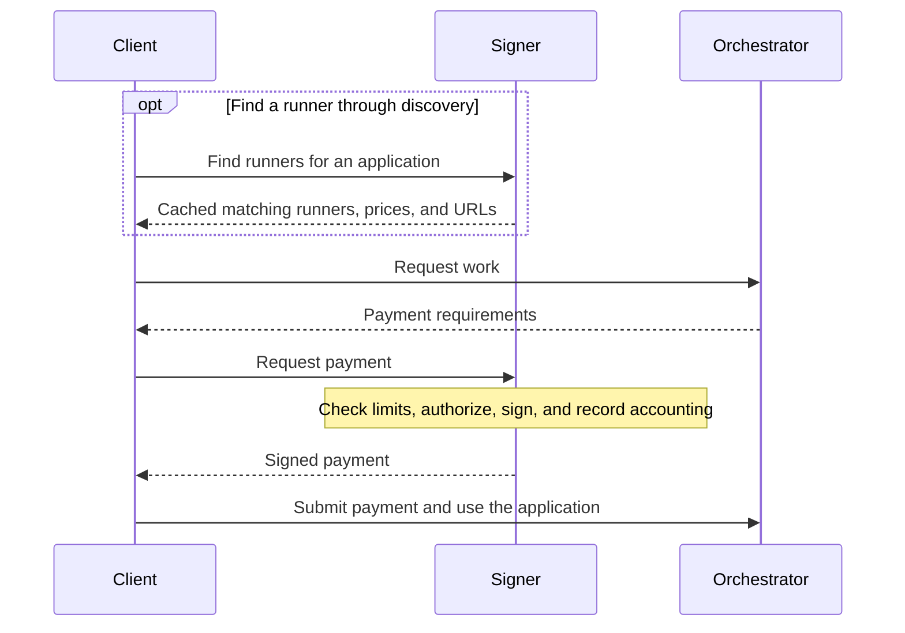

# Remote signer

The signer holds an Ethereum key, authorizes and signs client payments, and
discovers orchestrators and their runners. Clients need neither private keys
nor RPC access; application traffic goes directly to the orchestrator:



## Run a signer

Copy the [configuration example](../configs/signer/config.example.toml) to
`/etc/livepeer/signer.toml` and configure:

- `KeystoreFile` and `KeystorePasswordFile`: the encrypted geth keystore
  used to sign payments.
- `RPCURLFile`: the file containing the Ethereum RPC URL.
- `MaxHourlyPrice` and `MaxFixedPrice`: positive price limits in USD, described
  under [payment limits](#set-payment-limits).

The signer requires an on-chain connection. The Controller and ETH/USD feed
defaults are for Arbitrum mainnet; override them for another chain. See
[configuration and secrets](configuration.md) for key and credential formats.

Before making payments, fund the signer's account with both a TicketBroker
deposit and reserve using the [chain CLI](chain.md).

Start the signer; check readiness from another terminal:

```sh
livepeer signer --config /etc/livepeer/signer.toml
```

```sh
curl -fsS http://127.0.0.1:8938/readyz
```

The signer API listens on `127.0.0.1:8937` by default; set `Listen` to change
that address. Keep it on a private network or behind an authenticated proxy,
and configure TLS termination at the proxy.

## Configure discovery

Set `Orchestrators` to orchestrator or standalone [discovery](discovery.md)
base URLs to query. Both expose the same inventory API. Local or private sources
also need [destination grants](configuration.md#destination-grants). For example:

```toml
Orchestrators = ["http://127.0.0.1:8935"]
DiscoveryGrants = ["127.0.0.1:8935"]
```

The signer appends `/discovery` to static base URLs and uses webhook URLs unchanged.
It polls at startup and every `DiscoveryRefreshInterval` (positive, default `5m`).
Fetches have a five-second timeout and 1 MiB response limit. Failed polls retain
the last inventory until `DiscoveryMaxFailedRefreshes` consecutive failures
(default `6`, nonnegative) remove it; `0` evicts on the first failure. Recovered
sources reappear on subsequent polls.

Query by application and GPU; omit either filter to broaden the results:

```sh
curl -fsS 'http://127.0.0.1:8937/discover-orchestrators?app=example&gpu=H100'
```

Results describe matching runners, prices, capacity, and application URLs.
Discovery neither reserves capacity nor applies payment ceilings; clients must
request work, and signing enforces price limits. See the
[discovery reference](http-api.md#discovery-filters-and-results) for fields and
filter rules.

## Orchestrator discovery webhook

To use a webhook instead of `Orchestrators`, configure:

```toml
OrchestratorWebhookFile = "/run/secrets/livepeer-signer-orchestrator-url"
# OrchestratorWebhookHeadersFile = "/run/secrets/livepeer-signer-orchestrator-headers"
OrchestratorWebhookRefreshInterval = "5m"
```

Use the [credential-file rules](configuration.md#credential-files) for URL and
header secrets; private destinations need `DiscoveryGrants`.

GET at the webhook URL returns `[{"address":"https://orch.example.com/discovery"}]`.
Addresses are complete HTTP(S) discovery URLs without credentials, queries, or
fragments. Invalid addresses and extra fields are ignored.

Fetches run at startup and every positive `OrchestratorWebhookRefreshInterval`
(default `5m`), with a three-second timeout, 1 MiB limit, and no redirects.
Before the first successful list, discovery requests trigger or await a fetch;
failures return 503. Later requests use the cache during refreshes and failures;
a successful empty response clears it. Returned sources use the inventory
polling settings above.

## Connect a client

Configure the signer's base URL and proxy credentials; authenticate every signer
request. Clients need access to both signer and orchestrator, found through
discovery or a known runner URL. Follow the
[signer HTTP API](http-api.md#remote-signer-http), retaining returned signed state
unchanged for subsequent payments in the same session. The
[SDK fixtures](development.md#sdk-integration-fixtures) list tested versions and flows.

## Set payment limits

Price limits control how much the signer will agree to pay for work:

| Setting | Limit |
| --- | --- |
| `MaxHourlyPrice` | USD per hour for work billed by duration. |
| `MaxFixedPrice` | USD per request for work billed at a fixed price. |

The signer uses its ETH/USD feed to compare these limits with the orchestrator's
price. Clients and authorization webhooks can supply an additional `maxPrice`
in wei. Every applicable ceiling must be satisfied, and subsequent payments
cannot exceed the session's initial unit price. See the
[payment limit reference](http-api.md#payment-limits-and-refresh) for units and
exchange-rate behavior.

Use `MaxTicketEV`, `MaxBatchEV`, and `DepositMultiplier` to constrain ticket
exposure independently of the work price. These limits do not cap cumulative
spending. Enforce an overall budget through an authorization service or
clearinghouse that tracks spending and decides whether to approve each payment.
Clients hold the signed payment state, and earlier state can be reused;
retries can generate separate payments.

## Authorization

Use an authorization webhook to enforce caller budgets and price ceilings.
Set `AuthWebhookFile` to a URL file and, for authentication,
`AuthWebhookHeadersFile` to a comma-separated header file, such as
`Authorization: Bearer credential`. Omit these settings to disable the webhook.
The signer sends client headers and proposed payment state and returns payment
credentials only after approval. See the
[webhook reference](http-api.md#authorization-webhook) for requests and decisions.

Omit `expiry` or return zero to authorize every payment. A future Unix timestamp
caches approval and its price ceiling until expiry, delaying revocation and
budget checks. Signed state becomes a bearer credential during cached approval.
A proxy must authenticate requests and overwrite untrusted `Signer-` headers.
`Signer-Auth-Id` by itself does not authenticate a caller.

## Kafka accounting and budgets

Configure Kafka with the authorization webhook when a clearinghouse uses signing
events to enforce budgets. `[Kafka]` requires a bootstrap broker and topic:

```toml
[Kafka]
Broker = "kafkas://broker.example.com:9096"
Topic = "livepeer-signing"
UsernameFile = "/run/secrets/kafka-username"
PasswordFile = "/run/secrets/kafka-password"
OutboxDB = "/var/lib/livepeer/signer-events.sqlite"
```

Settings also accept `--kafka-*` flags and `LIVEPEER_SIGNER_KAFKA_*` variables.
Any Kafka setting enables accounting; omit all to disable it. `Broker` accepts
one `host[:port]` (bracket IPv6): TLS with system trust by default, `kafkas://`
for TLS or `kafka://` for plaintext. Credentials, paths, queries, and fragments
are rejected. Advertised brokers must use the same transport and authentication.

Paired username/password secrets enable SASL; use files or
`LIVEPEER_SIGNER_KAFKA_USERNAME` / `LIVEPEER_SIGNER_KAFKA_PASSWORD`.
`AuthMethod` accepts `plain`, `scram-sha-256`, or `scram-sha-512` (default).
Without credentials SASL is disabled. Set the port explicitly or use these defaults:

| Connection | Port |
| --- | --- |
| Plaintext without SASL | 9092 |
| TLS without SASL | 9093 |
| SASL/SCRAM, with or without TLS | 9096 |
| SASL/PLAIN, with or without TLS | 9094 |

Give each replica its own durable outbox. Events are persisted before payment
responses and delivered at least once; consumers must deduplicate IDs. Separate
signing requests produce separate events, even if responses are interrupted.
Accounting lag can allow budgets to be exceeded before authorization stops
payment. See [event formats and limits](http-api.md#accounting-events) and
[backup/recovery](payment-recovery.md#signer-accounting-recovery).

## Readiness and monitoring

Use the metrics listener (default `127.0.0.1:8938`):

```sh
curl -fsS http://127.0.0.1:8938/healthz
curl -fsS http://127.0.0.1:8938/metrics
```

`/healthz` checks liveness. `/readyz` requires chain access, positive deposit and
total reserve, no withdrawal scheduled at or before the next round, a fresh
exchange rate, and healthy enabled outbox storage with capacity. Kafka
connectivity alone does not affect readiness. Recipient-specific claimable
reserve is checked during payment generation.

Monitor backlog, errors, and filesystem space. `/metrics` exposes:

- `livepeer_signer_up`
- `livepeer_signer_kafka_pending_events`
- `livepeer_signer_kafka_pending_bytes`
- `livepeer_signer_kafka_oldest_event_age_seconds`
- `livepeer_signer_kafka_outbox_healthy`
- `livepeer_signer_kafka_publish_errors_total`
- `livepeer_signer_kafka_enqueue_errors_total`
- `livepeer_signer_kafka_storage_errors_total`

Replicas with the same key and authorization configuration can continue
client-held signed state. Keep a separate durable outbox for each replica.
